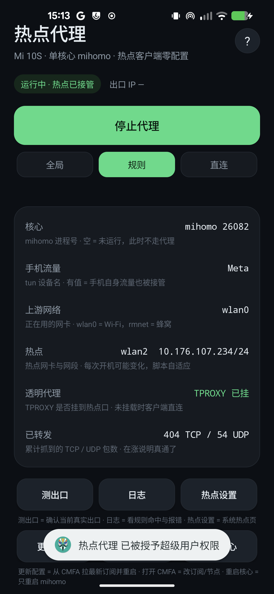

# AnyOpen

> Turn a rooted Android phone into a **hotspot gateway with transparent proxying**. Clients that join the hotspot go through your proxy automatically — no per-device app, no manual proxy settings.



## Why

Every Android proxy app (Clash, sing-box, v2rayNG) works through `VpnService`: its tun only captures **the phone's own** traffic. Packets forwarded from hotspot clients never touch that tun, so "install a proxy, turn on hotspot" proxies the phone only.

AnyOpen redirects hotspot traffic into a root-owned mihomo with `iptables TPROXY`, and lets the same instance own a tun for the phone. One core, one rule set, one exit.

```
client ──wlan2──▶ PREROUTING ──mark──▶ TPROXY:7895 ──▶ mihomo ──▶ node ──▶ internet
phone  ──────────────────────────────▶ tun "Meta"  ──▶ (same rules)
```

## Features

- Zero client configuration, DNS included (fake-ip), UDP/QUIC handled
- Single core shared by the phone and the hotspot
- Self-healing: netd flushes iptables on network changes; a watchdog re-installs rules every 5s
- Follows the real upstream (Wi-Fi ↔ cellular) automatically
- Fail-open: if the core dies, the TPROXY hook is removed so clients fall back to direct
- Config regeneration on device from your Clash subscription, validated before swapping
- Control app + embedded MetaCubeXD dashboard

## Requirements

- Unlocked bootloader, rooted (Magisk / KernelSU / APatch)
- Android 11+, kernel with `CONFIG_NF_TPROXY_IPV4`
- A Clash Meta subscription (defaults to Clash Meta for Android's cache)

## Quick start

```bash
git clone https://github.com/AfeiFun/AnyOpen.git && cd AnyOpen
./scripts/install.sh
./scripts/build-app.sh
adb install -r app/app/build/outputs/apk/debug/app-debug.apk
```

Then: enable the system hotspot → open the app → tap **启动代理**.

## Docs

- [docs/architecture.md](docs/architecture.md) — components, ports, iptables layout, boot flow
- [docs/troubleshooting.md](docs/troubleshooting.md) — every pitfall found while building this
- Chinese README: [README.md](README.md)

## License

[MIT](LICENSE).
