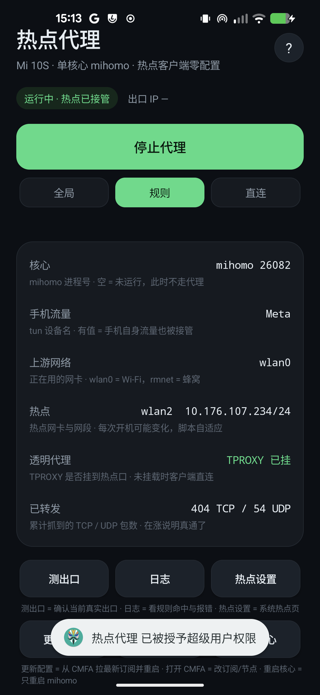

# AnyOpen

> 把一台 Root 过的安卓手机，变成**带透明代理的热点网关**：客户端连上热点就全局走代理，不需要在每台设备上装 App 或填代理。



---

## 它解决什么问题

安卓上所有代理 App（Clash、sing-box、v2rayNG）都靠 `VpnService` 建一块 tun，**只接管手机自己的流量**。
热点客户端的包走内核转发，根本不经过 tun——所以「装个代理再开热点」，只能让手机自己翻，客户端的流量照样直连。

AnyOpen 的做法：用 `iptables TPROXY` 把从热点的包抓到本地端口，交给一个 root 权限的 mihomo 处理；
同时让 mihomo 用 tun 接管手机自己，于是**手机和热点客户端共用同一套规则、同一个出口**。

```
                 ┌─────────────── 手机自己 ───────────────┐
                 │  tun "Meta"  (table 2022, fake-ip)      │
                 │        │                                │
   客户端 ──wlan2──▶ PREROUTING ──mark──▶ TPROXY:7895 ──▶ mihomo ──▶ 节点 ──▶ 互联网
  (iPhone/笔电)   └────────────────────────────────────────┘
```

## 特性

- **客户端零配置**：DNS 也被接管（fake-ip），UDP/QUIC 一并处理
- **单核心**：手机与热点共用一份配置、一套分流规则
- **自愈**：netd 网络切换会清规则，守护每 5 秒检查并重装（链存在、链里有规则、策略路由都在才算健康）
- **跟随上游**：Wi-Fi ↔ 蜂窝切换时自动识别真正在用的网卡并重启核心，不会悄悄走错出口
- **失败即放行**：核心不可用时主动摘掉 TPROXY 钩子，客户端退回直连而不是全黑洞
- **可自助更新**：手机上一条命令从订阅重新生成配置，先校验再替换
- **带界面**：控制 App + 内嵌的 MetaCubeXD 面板（切节点、看连接、查规则命中）

## 环境要求

| 项 | 要求 |
|---|---|
| 设备 | 已解锁 Bootloader、已 Root（Magisk / KernelSU / APatch） |
| 系统 | Android 11+，需要内核开启 `CONFIG_NF_TPROXY_IPV4` |
| 上游 | 订阅由 [Clash Meta for Android](https://github.com/MetaCubeX/ClashMetaForAndroid) 管理（默认从它的缓存读取） |

不确定内核是否支持 TPROXY，可以这样验：

```sh
su -c 'iptables -t mangle -N T; iptables -t mangle -A T -p tcp -j TPROXY --on-port 7895 --tproxy-mark 1; echo ok'
```

## 快速开始

```bash
git clone https://github.com/AfeiFun/AnyOpen.git && cd AnyOpen
./scripts/install.sh            # 下载 mihomo、推送脚本、生成配置、拉起守护
./scripts/build-app.sh          # 构建控制 App
adb install -r app/app/build/outputs/apk/debug/app-debug.apk
```

装完后：打开系统热点 → 打开 App → 点「启动代理」。之后每次开机守护会自动起来，热点开一下就自动挂上规则。

> 仓库里带了一个一次性的 debug keystore，只为「clone 下来就能构建」，请不要用它发布正式包。

> 订阅来源默认取 Clash Meta for Android 的缓存。如果你用别的客户端：
> `su -c 'PROFILE=/sdcard/my-config.yaml sh /data/adb/hotspot/regen.sh'`

## 控制 App

| 区域 | 说明 |
|---|---|
| 状态卡 | 核心 PID、tun 设备、上游网卡、热点网段、TPROXY 是否挂载、转发计数（3 秒刷新） |
| 主按钮 | 启动 / 停止整条链路；长按重启核心 |
| 全局 / 规则 / 直连 | 三种分流模式，即时生效并写回配置 |
| 开启 / 关闭热点 | 代你完成「开设置页 → 点开关 → 回 App」，并校验结果 |
| 测出口 / 日志 | 打一次 `api.ip.sb` 看出口；看 run.log 与 core.log |
| 更新配置 | 从订阅重新生成配置并重启（先校验后替换） |
| 面板 | 内嵌 MetaCubeXD：连接、代理组、规则、流量曲线 |

## 分流与模式

规则、节点、策略组全部来自你的订阅（标准 Clash Meta YAML），本项目只覆盖基础设施字段：

```
port / socks-port / allow-lan / external-controller   ← 避开订阅客户端的端口
dns.listen / enhanced-mode                            ← 让热点客户端能用 DNS
listeners(tproxy) / tun / interface-name               ← 热点 + 手机接管
```

三种模式走 mihomo 运行时接口，切换即时生效：

| 模式 | 行为 |
|---|---|
| 规则 | 按订阅 `rules` 分流（默认） |
| 全局 | 全部走代理（会自动把 `GLOBAL` 组指向规则里 `MATCH` 的目标，避免它默认选中 `DIRECT`） |
| 直连 | 全部不走代理，热点照常 |

## 维护命令

```sh
su -c 'sh /data/adb/hotspot/hs status'    # 人类可读状态
su -c 'sh /data/adb/hotspot/hs probe'     # key=value，给脚本/App 用
su -c 'sh /data/adb/hotspot/hs mode global|rule|direct'
su -c 'sh /data/adb/hotspot/hs regen'     # 重新生成配置
su -c 'sh /data/adb/hotspot/hs off|on|restart'
```

## 已知限制

- **重启后热点不会自动开**：Android 不恢复网络共享状态，需要点一下（`cmd wifi` 没有 softap 子命令）
- **闲置 10 分钟自动关热点**：系统行为，充电时不触发；长期使用建议插着电
- 热点网卡名与网段**因 ROM 而异**，脚本已做多名字探测与自适应，仍可能在极少数机型上需要改 `device/run.sh` 里的 `ap()` 列表

## 踩过的坑

每一条都是实测踩出来的，写在 [docs/troubleshooting.md](docs/troubleshooting.md)：netd 清规则、`tetherctrl_mangle` 抢包、
代理套代理造成的 dial 超时、系统「VPN 共享」在部分 ROM 上把转发路由删空、新装应用被 `REJECT_ALL`
拦掉本地回环等等。

## 目录结构

```
device/     run.sh 守护 · hs 命令 · regen.sh 配置生成 · service.d 开机自启
app/        控制 App（纯 Java，零第三方依赖，编译产物 ~20 KB）
scripts/    install.sh · fetch-mihomo.sh · build-app.sh
docs/       架构说明与排错手册
```

## 卸载

```sh
su -c 'sh /data/adb/hotspot/hs off; rm -rf /data/adb/hotspot /data/adb/service.d/99-hotspot-proxy.sh'
adb uninstall dev.fly.hotspotctl
```

## 协议

[MIT](LICENSE)。仅供学习与自用，请遵守当地法律法规与网络服务条款。
